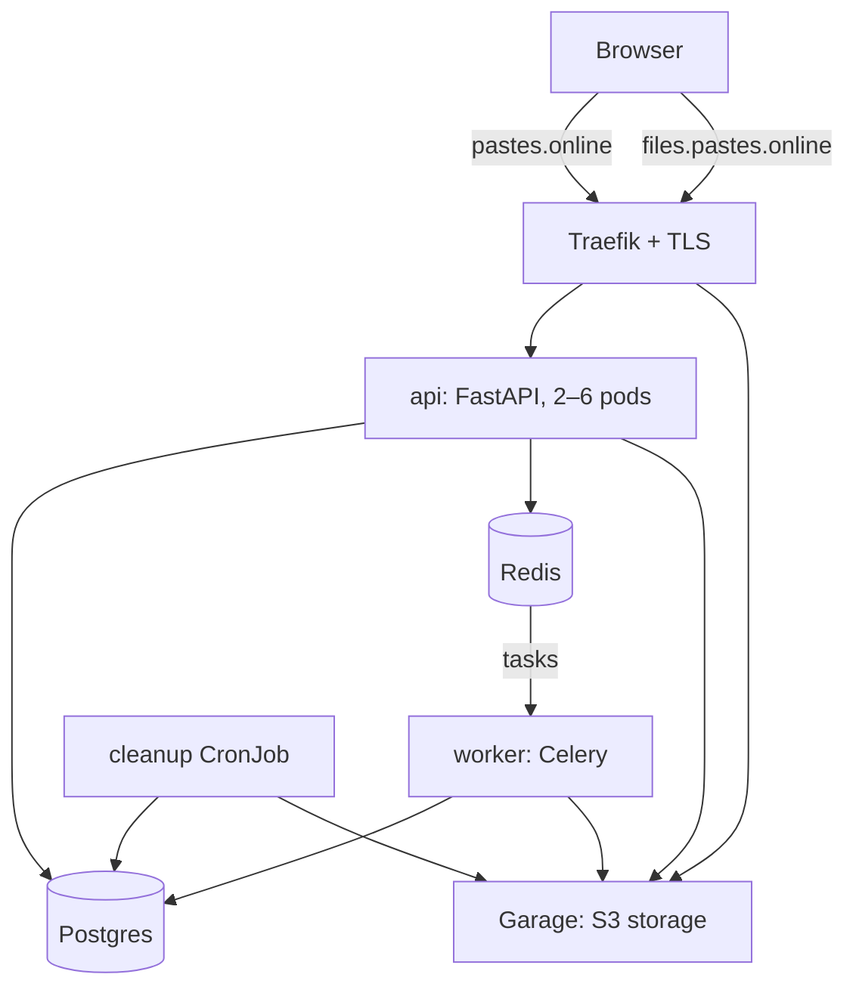
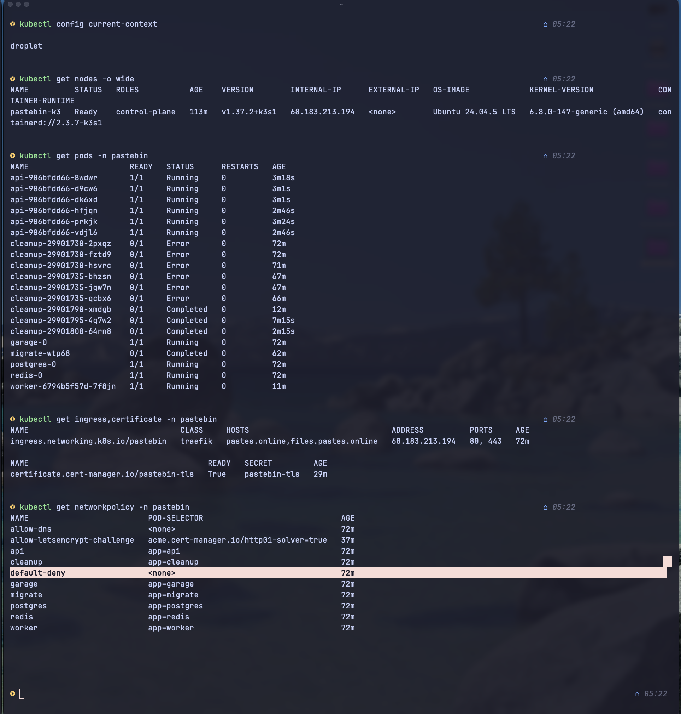
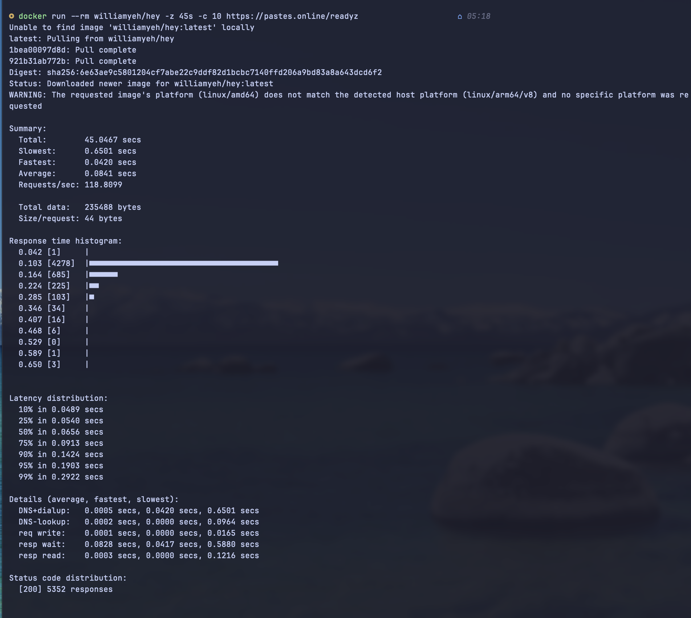

# pastebin

( DISCLAIMER: This is a backend project, so it features a simple AI Generated frontend, to showcase the backend )

A pastebin with image uploads, hosted on Kubernetes, on a DigitalOcean droplet.

** Full demo ( 1 min ):**

https://github.com/user-attachments/assets/1b2549ef-6aec-4356-9866-4c138927606c

A project that helped me understand Kubernetes better, and also learn a lot of new things along the way, like Kustomize or Garage.

> **Live demo:** it ran at `https://pastes.online` on a single-node k3s cluster. It's not kept online permanently i only bring it up when I work on it, to avoid paying extra for an idle server.

## Features

- Pastes: public / unlisted / private, expiry (1h, 1d, 1w, never), burn-after-reading
- Image uploads, straight from the browser to object storage, processed in the background
- Accounts with session cookies, rate limiting per user / per IP
- Expired pastes cleaned up automatically, images included

## Architecture



The api never touches the image bytes on upload, and the browser uploads them to Garage directly. A Celery worker processes the image afterwards. That's how the api stays fast, and big uploads don't block it at all.

## Stack

| part | tech |
| --- | --- |
| API | FastAPI, SQLModel, async SQLAlchemy |
| database | Postgres 17, Alembic migrations |
| queue / cache / rate limits | Redis |
| background jobs | Celery |
| object storage | Garage (S3-compatible) |
| images | Pillow |
| logging | structlog (JSON, request IDs) |
| deploy | k3s, Kustomize, Sealed Secrets, cert-manager, Traefik |

## How an image upload works

1. `POST /api/v1/images/upload-url`: the api checks the paste is yours and returns a presigned POST (5 minutes, max 5 MB, fixed content type)
2. the browser uploads the file directly to Garage
3. `POST /api/v1/images/{id}/complete`: the api checks the file exists and queues a task
4. the worker validates the real format, fixes orientation, re-encodes, makes a thumbnail, marks it ready
5. `GET /i/{id}` answers with a short-lived redirect to the image

## Kubernetes

| component | object |
| --- | --- |
| Postgres, Redis, Garage | StatefulSet + PVC |
| api | Deployment + HPA (2–6 pods, 70 % CPU) |
| worker | Deployment, no Service |
| migrations | Job, before every rollout |
| cleanup | CronJob, every 5 min, `concurrencyPolicy: Forbid` |
| secrets | Sealed Secrets (encrypted in git) |
| routing + TLS | Traefik Ingress, cert-manager + Let's Encrypt |
| network | NetworkPolicy: default-deny, then only the real paths |

`k8s/base` holds everything shared; `k8s/overlays/local` (k3d) and `k8s/overlays/droplet` (the real server) only hold the differences, more precisely: image tag, domain, TLS, sealed secrets.

### Hardening

- non-root, read-only root filesystem, no Linux capabilities, seccomp, on every pod running the app image
- NetworkPolicies: allow only the needed communications, block everything else
- graceful shutdown: `preStop` and `maxUnavailable: 0`, so rollouts don't drop requests
- connection budget: 6 api pods × 10 connections + worker + cleanup stays under Postgres's limit of 100

## Proofs

| what | how | result |
| --- | --- | --- |
| zero-downtime deploys | `hey` over the internet (TLS) while `kubectl rollout restart` (droplet) | **5,352 requests, all `200`**, p50 66 ms, p99 292 ms |
| the fix it proves | the same test inside the cluster, before and after adding `preStop` (k3d) | 2 `connection refused` out of 54k => **0 of 98k** after |
| autoscaling | the load above (droplet) | api scaled **2 => 6 pods**, back to 2 after ~5 min |
| data survives | `kubectl delete pod postgres-0` (k3d) | rows still there |
| network isolation | a pod without a label => Redis; a pod from another namespace => Postgres (k3d) | both blocked |
| read-only filesystem | `touch /app/x` inside the api pod (k3d) | `Read-only file system`, uploads still processed |
| secrets | delete the Secret (k3d) | recreated from the sealed file in git within seconds |




## Decisions and trade-offs

- **Rows first, files second when deleting:** if it crashes in between, the worst case is leftover files in Garage that nothing points to. The other way around, users would see pastes with broken images.
- **Fixed-window rate limiting in Redis:** simple, easy to understand, but still suffers from bursts at the window edge
- **Sessions as hashed tokens in Postgres**, over JWTs: logout works instantly
- **Burn-after-reading with `SELECT … FOR UPDATE`:** two people can't both read it
- **Celery `acks_late` + idempotent tasks:** a task might run twice after a crash, and that is harmless
- **The same image everywhere:** configured only by environment variables

## What went wrong and what I learned

- a new kombu release broke the worker in a fresh build: the code didn't change, but an unpinned dependency did, so I pinned it
- rollouts dropped a few requests until `preStop`
- NetworkPolicies kept old connections alive, so problems only showed after restarts

## Run it locally

```bash
cp .env.example .env            # fill in the values
docker compose up --build
# http://localhost:8000
```

Tests: `pytest` (28 tests: auth, pastes, images).

On k3d: use `scripts/deploy-local.sh`

## API

| method | path | what |
| --- | --- | --- |
| POST | `/api/v1/auth/register`, `/login`, `/logout` | accounts |
| GET | `/api/v1/auth/me` | current user |
| POST | `/api/v1/pastes/` | create a paste |
| GET | `/api/v1/pastes/` | public pastes |
| GET | `/api/v1/pastes/me/pastes` | my pastes |
| GET | `/api/v1/pastes/{id}`, `/{id}/raw` | view a paste |
| POST | `/api/v1/pastes/{id}/reveal` | read a burn-after-reading paste once |
| DELETE | `/api/v1/pastes/{id}` | delete (with its images) |
| POST | `/api/v1/images/upload-url`, `/{id}/complete` | image upload |
| GET | `/i/{id}` (`?thumb=1`) | view an image |
| GET | `/healthz`, `/readyz` | liveness / readiness |

## Still not implemented

- real client IPs behind the load balancer, HTTP => HTTPS redirect
- moderation (reports, takedown) before the demo can stay online
- a dependency lock file, CI with GitHub Actions
- roles, user profiles, full-text search, a view counter, edit history
